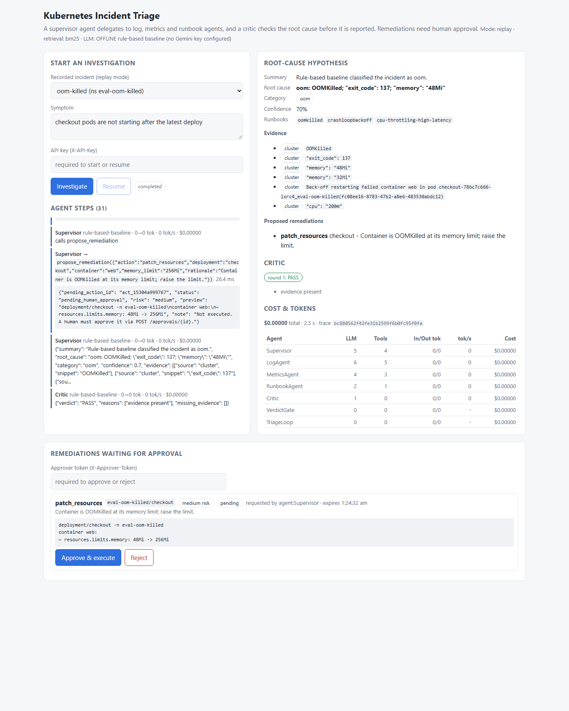
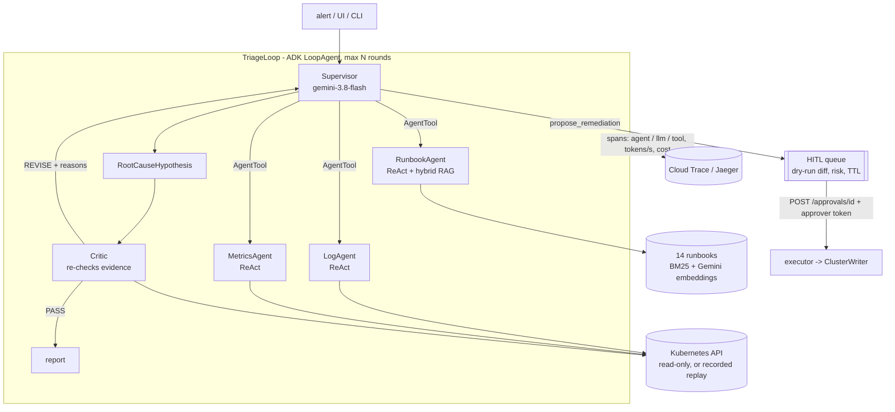
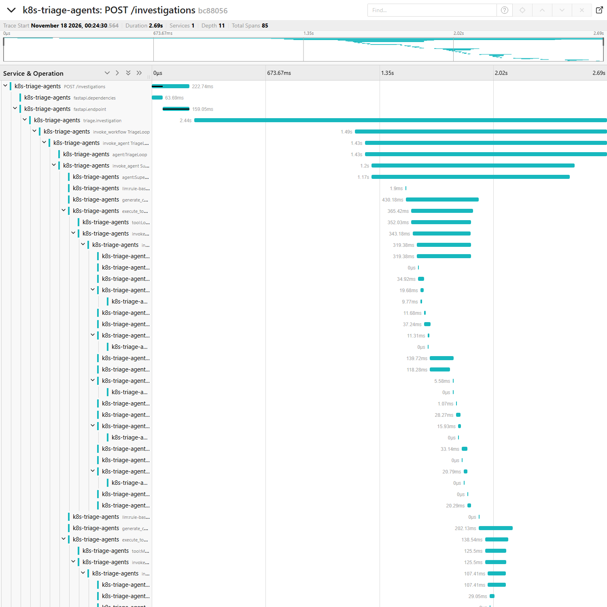

# Multi-Agent Incident Triage for Kubernetes

**A supervisor agent built with Google's Agent Development Kit (ADK) and Gemini investigates a broken Kubernetes namespace. It delegates to log, metrics and runbook-retrieval specialists, has a self-reflection critic check the root cause, and queues fixes for human approval. Every step is traced with OpenTelemetry.**

[](LICENSE)


-8%2F8-brightgreen)


> **Live demo:** _pending deployment._ `scripts/deploy.sh` is ready, but the build machine had no authenticated `gcloud` session. See [STATUS.md](STATUS.md).
> CI/eval badges get added once the workflows are enabled (see [STATUS.md](STATUS.md)). The badges above come from local runs on 2026-11-17.


<sub>The console after an investigation of the recorded `oom-killed` incident. This screenshot was taken in **offline baseline mode** (`LLM_BACKEND=baseline`, a deterministic stand-in for Gemini; no API key was available). The banner says so, and token and cost figures are therefore 0.</sub>

---

## What it does



| Resume claim | Where it lives |
|---|---|
| Hierarchical multi-agent system on **Google ADK + Gemini** | [`agents/factory.py`](src/triage/agents/factory.py): a `LoopAgent` containing the Supervisor `LlmAgent`, which calls workers through `AgentTool`, then the Critic, then `VerdictGate` |
| Log / metrics / runbook sub-agents, each a **ReAct tool-calling loop** against the **Kubernetes API** | ADK `PlanReActPlanner` on each worker; [`tools/cluster_tools.py`](src/triage/tools/cluster_tools.py) over [`k8s/live.py`](src/triage/k8s/live.py) (official client); per-agent tool budget + `max_llm_calls` |
| **Self-reflection critic** verifies the hypothesis before it's reported | Critic agent with its own prompt and read-only verification tools; REVISE sends the supervisor back with reasons ([`test_critic_revise_triggers_second_round`](tests/unit/test_agent_flow.py)) |
| **Persistent sessions**, investigations **resume after failure** | ADK `DatabaseSessionService` + `ResumabilityConfig`; [`test_crash_then_resume_continues_from_checkpoint`](tests/unit/test_resume.py) kills a run mid-way and proves finished steps are not redone |
| Every remediation **gated behind human approval** | [`hitl/service.py`](src/triage/hitl/service.py); [`test_hitl.py`](tests/unit/test_hitl.py) and [`test_api.py`](tests/unit/test_api.py) prove the executor is unreachable without the approver token |
| **OpenTelemetry / Cloud Trace** with per-agent **tokens/sec, cost per request, latency** | [`telemetry/plugin.py`](src/triage/telemetry/plugin.py) ADK plugin + [`pricing.py`](src/triage/telemetry/pricing.py); Cloud Trace exporter; waterfall below |
| **Eval suite replays injected-fault scenarios on a test cluster** before release | [`eval/`](eval): 8 faults on kind, scored and gated at accuracy ≥ 0.75; [`.github/workflows/eval.yml`](.github/workflows/eval.yml) |

## How it works: one incident in 60 seconds
Recorded `oom-killed` incident (fixture captured from kind). These are the actual tool calls from the run in the screenshot (offline baseline model; with Gemini the *choice* of calls is the model's):
1. **Supervisor** reads the symptom ("checkout keeps restarting…") and delegates to **LogAgent**.
2. **LogAgent** (ReAct): `list_pods` → `describe_pod checkout-78bc7c666-lxrc4` (last state `terminated`, reason `OOMKilled`, exit code `137`) → `get_events` (`Back-off restarting failed container web…`) → `get_pod_logs(previous=true)` (the kubelet had already rotated them: "unable to retrieve container logs", a real-world wrinkle the fixture preserves) → `list_services`.
3. **MetricsAgent**: `get_pod_resource_usage` (limit `memory: 48Mi`; no usage sample yet because the container had just restarted) → `get_restart_counts` (exit code 137) → `list_deployments`.
4. **RunbookAgent**: `search_runbooks("OOMKilled exit code 137 memory limit")` returns `oomkilled#symptoms` and `oomkilled#likely-causes` first, with chunk-level citations.
5. **Supervisor** calls `propose_remediation(patch_resources, container=web, memory_limit=256Mi)`. That only files `act_…` with the dry-run preview `resources.limits.memory: 48Mi -> 256Mi` at risk `medium`. The supervisor then emits a `RootCauseHypothesis`: category `oom`, verbatim evidence, runbook refs.
6. **Critic** reviews the hypothesis in isolation and returns **PASS**, so `VerdictGate` ends the loop. The Gemini critic is instructed to re-check the decisive fact with `describe_pod` / `get_events` / `get_pod_logs`; the baseline critic only checks that a category and evidence exist. On **REVISE** the supervisor runs another round with the critic's missing-evidence list.
7. On-call clicks **Approve & execute** with the approver token. The executor patches the deployment (simulated in replay mode), and the audit log records `proposed → approved → executed`.

## Evaluation results (real runs)
| Run (2026-11-17) | Model | Cluster | Root-cause acc. | Evidence recall | Runbook hit@3 | Critic agreement | p50 latency |
|---|---|---|---|---|---|---|---|
| [live-kind-baseline](eval/results/live-kind-baseline.md) | rule-based baseline | **live kind v1.33.1, faults injected** | 8/8 | 0.917 | 1.00 | 1.00 | 1.14 s |
| [offline-baseline](eval/results/offline-baseline.md) | rule-based baseline | recorded fixtures | 8/8 | 0.917 | 1.00 | 1.00 | 1.10 s |
| Gemini (replay and live) | gemini-3.8-flash + 3.1-flash-lite | both | **pending** | pending | pending | pending | pending |

The baseline is a deterministic, rule-based stand-in model, written knowing these 8 faults. These rows prove the pipeline end to end: fault injection, the live API, fixture fidelity, tools, retrieval, the HITL path and scoring. **They are not a Gemini accuracy number.** The Gemini runs need a `GEMINI_API_KEY`, which wasn't available during the build; see [docs/EVAL.md](docs/EVAL.md).

## Observability

<sub>One investigation, 85 spans, exported over OTLP to Jaeger (docker-compose). ADK's native `invoke_agent` / `execute_tool` / `generate_content` spans nest with ours: `agent:<name>`, `llm:<model>` (with `llm.input_tokens`, `llm.output_tokens`, `llm.tokens_per_sec`, `llm.cost_usd`, `latency_ms`) and `tool:<name>`. In production the same spans go to **Cloud Trace** (`TRACE_EXPORTER=gcp`). A Cloud Trace screenshot is pending deployment.</sub>

- **Cost per request:** a per-model price table ([`pricing.py`](src/triage/telemetry/pricing.py), checked 2026-11-17) times tokens per LLM call. It's aggregated across nested AgentTool runs and set on the root span (`llm.cost_usd`), and returned in `GET /investigations/{id}` → `cost_usd` with a per-agent breakdown.
- **Metrics** (OTel → Cloud Monitoring, `workload.googleapis.com/triage.*`): request latency, tokens/sec per agent, cost per request, critic verdicts (rejection rate), approval wait time. The dashboard is [`deploy/dashboards/cloud-monitoring-dashboard.json`](deploy/dashboards/cloud-monitoring-dashboard.json). There's also `GET /metrics/summary`.
- **Cost of one investigation with Gemini:** _pending a keyed run._ Each run reports it, and the run-wide guardrails (`MAX_LLM_CALLS=60`, 8 tool calls per worker, 2 critic rounds) bound it.

## Human-in-the-loop
Agents have **no** tool that changes the cluster. `propose_remediation` validates against an allowlist (`rollout_restart`, `scale_deployment`, `rollback_deployment`, `patch_resources`), computes a **dry-run diff** from live state, assigns a **risk** level (scale-down is HIGH), and stores a `PendingAction` that expires after 60 minutes. Only `POST /approvals/{id}` with `X-Approver-Token` (a different secret from the API key) reaches the executor. Every attempt is audited, including bad tokens. ADK's built-in `require_confirmation` was deliberately not used, because it blocks the invocation until answered; see [DECISIONS D6](docs/DECISIONS.md).

## Persistent sessions and resume
Each investigation is an ADK session in `DatabaseSessionService` (SQLite locally; Postgres or Vertex AI Agent Engine sessions in the cloud via `SESSION_DB_URL`). The ADK app is `ResumabilityConfig(is_resumable=True)`: every event and state delta is persisted as it happens, and `after_agent_callback`s record a checkpoint per sub-agent step. If the process or the model dies, the investigation is `failed` with its `last_invocation_id`. `POST /investigations/{id}/resume` calls `runner.run_async(invocation_id=…)` and continues from the last event; completed sub-agents are not re-run (that's what the test asserts).

## Quickstart
```bash
git clone https://github.com/nikhil3495/k8s-triage-agents && cd k8s-triage-agents
uv sync && cp .env.example .env            # add GEMINI_API_KEY

# 1) Local API + UI + Jaeger
docker compose up --build                   # UI http://localhost:8080, traces http://localhost:16686
# or without Docker:
uv run uvicorn triage.api.app:app --port 8080
#   no key? LLM_BACKEND=baseline runs the offline stand-in (clearly labelled)

# 2) CLI
uv run triage investigate --scenario oom-killed --symptom "checkout keeps restarting"
uv run triage approve <action_id> --token "$APPROVER_TOKEN"

# 3) ADK dev UI - step through every agent / LLM call / tool call
uv run adk web adk_agents

# 4) Live mode against kind
kind create cluster --name triage-eval
CLUSTER_MODE=live uv run triage investigate --namespace <ns> --symptom "..."
uv run python -m eval.run_eval --mode live --model gemini --record   # inject 8 faults, score, refresh fixtures

# 5) Cloud Run (asia-south1, replay mode, min 0 / max 2 instances)
gcloud auth login && gcloud config set project <id>
GEMINI_API_KEY=... ./scripts/deploy.sh      # deploys + runs scripts/smoke_test.sh
```

## Engineering
- Python 3.12, `uv`, `ruff` (lint + format), **`mypy --strict`** on `src/`, 83 tests, **96% coverage** (LLM-free: a scripted fake model drives the *real* ADK graph). Structured JSON logs.
- Unit tests mock the LLM and the cluster. Integration tests run the whole graph over the 8 fixtures recorded from kind.
- CI: lint, mypy, tests + coverage, offline eval, Docker build, gitleaks, pip-audit. Release gate: kind eval with Gemini. Deploy: Cloud Build → Artifact Registry → Cloud Run via Workload Identity Federation.
- Multi-stage, non-root Docker image. RBAC: read-only ClusterRole for investigators and a separate namespaced Role for remediation ([`deploy/k8s-rbac`](deploy/k8s-rbac)).
- Docs: [ARCHITECTURE](docs/ARCHITECTURE.md) · [DECISIONS](docs/DECISIONS.md) · [EVAL](docs/EVAL.md) · [SECURITY](docs/SECURITY.md) · [RUNBOOK](docs/RUNBOOK.md)

## Limitations (honest)
- **No Gemini numbers yet.** Every eval so far used the rule-based baseline; the Gemini eval rows are pending a keyed run.
- **The public demo runs on recorded snapshots** (replay mode, simulated writer), not a live cluster. The snapshots are real `kind` captures, but they are frozen in time.
- Metrics come from metrics-server (usage vs limit). CPU throttling is inferred from usage near the limit, not from cgroup `nr_throttled`. There's no Prometheus integration yet.
- API key and approver token are static secrets. Production should put IAP/OIDC in front and map approvers to identities.
- The Vertex AI Agent Engine session backend for Cloud Run is wired but not yet exercised end to end. SQLite is the tested path.
- The rate limiter is per instance.

## Roadmap
- Run and publish the Gemini eval (replay + live kind); tune prompts on failures; raise the gate.
- Migrate `LoopAgent` to ADK `Workflow` (LoopAgent is deprecated in ADK 2.x).
- Prometheus tool for the MetricsAgent (throttling counters, latency SLOs); HPA/PVC/DNS/node fault scenarios.
- Slack/PagerDuty webhook intake and approval buttons; OIDC approvers.

## License
MIT
