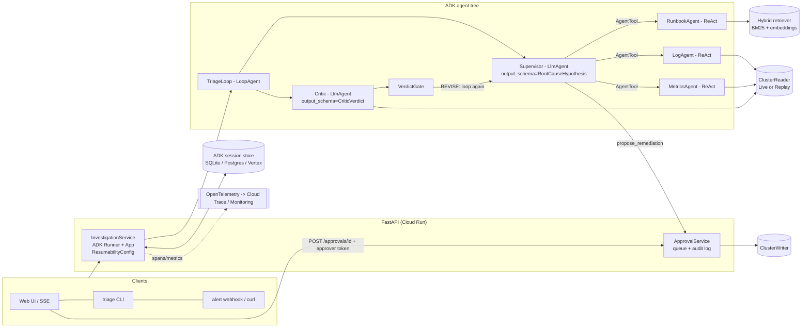

# Architecture

## Request lifecycle
1. `POST /investigations` (needs `X-API-Key`) creates an ADK session. Its initial state holds the namespace, symptom, scenario and cluster mode. An `investigations` row is added, and the run starts as a background task.
2. `TriageLoop` (a `LoopAgent`) runs **Supervisor, then Critic, then VerdictGate**.
3. The Supervisor plans and calls `LogAgent` / `MetricsAgent` / `RunbookAgent` through `AgentTool`. Each worker runs a `PlanReActPlanner` loop over its own read-only tools, under a tool-call budget. Their state deltas (checkpoints, citations, budgets) are forwarded into the parent session.
4. The Supervisor may call `propose_remediation`. That **only** files a `PendingAction` with a dry-run preview and a risk level. It then emits a `RootCauseHypothesis`, stored at `state["hypothesis"]`.
5. The Critic sees only the hypothesis (`include_contents="none"`), re-checks the decisive fact with read-only tools, and writes a `CriticVerdict`. An `after_agent_callback` appends it to `state["critic_history"]`.
6. `VerdictGate` escalates on PASS. On REVISE the loop repeats, with the critic's feedback injected into the Supervisor's instruction (at most `MAX_CRITIC_ROUNDS` rounds).
7. Every event is persisted by the session service. A crash leaves the investigation `failed` with `last_invocation_id`; `POST /investigations/{id}/resume` continues from there.
8. `TelemetryPlugin` emits spans and per-agent usage. The investigation's root span carries the total cost, which is also returned in `GET /investigations/{id}`.
9. A human approves with `POST /approvals/{id}` and `X-Approver-Token`. Only then does the executor call the `ClusterWriter`. Replay mode uses a simulated writer.

## Modules
| Path | Responsibility |
|---|---|
| `src/triage/agents/factory.py` | builds the tree; `Models` makes the LLM per role injectable |
| `src/triage/agents/prompts.py`, `schemas.py` | instructions and the structured outputs |
| `src/triage/agents/baseline.py` | deterministic offline stand-in model (CI / no-key demos) |
| `src/triage/tools/` | read-only cluster tools, runbook search, `propose_remediation` |
| `src/triage/k8s/` | `ClusterReader` / `ClusterWriter`, live client, replay client, normalizers, snapshot capture |
| `src/triage/rag/` | chunking, Gemini embeddings, hybrid retriever and index I/O |
| `src/triage/sessions/` | session-service factory, checkpoint/budget/critic callbacks |
| `src/triage/hitl/` | pending-action model, preview, risk, approval service, executor |
| `src/triage/telemetry/` | OTel setup, ADK plugin, pricing, metrics |
| `src/triage/investigations.py` | lifecycle, resume, SSE fan-out, reports |
| `src/triage/api/` | FastAPI app and the single-page UI |
| `src/triage/cli/` | `triage` CLI |
| `eval/` | scenarios, kind harness, scoring, `run_eval.py`, recorded fixtures |
